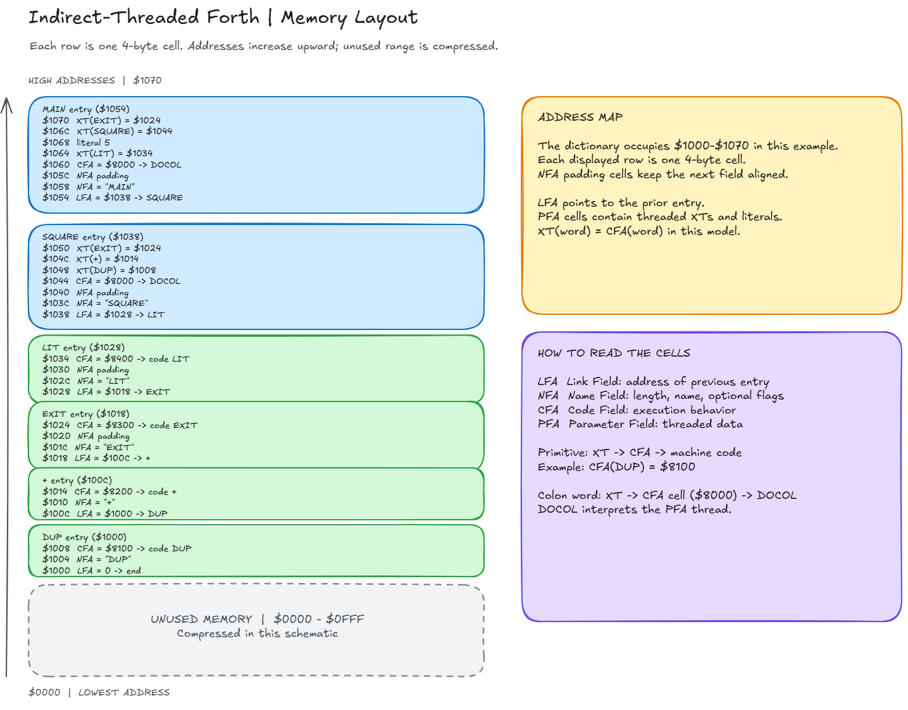

# Indirect Threaded Forth: XT, CFA, and Dictionary Layout

## 1. Example Forth Program

Consider the following Forth program:

```forth
: SQUARE DUP + ;
: MAIN   5 SQUARE ;
```

We will use this small program to explain:

- Indirect Threaded Code (ITC)

- Execution Token (XT)

- Code Field Address (CFA)

- Parameter Field Address (PFA)

- Link Field Address (LFA)

- Name Field Address (NFA)

- `DOCOL`

- `LIT`

- `EXIT`

- The Forth dictionary

- How the inner interpreter executes threaded code

---

## 2. Execution Token: XT

An **Execution Token**, or **XT**, is the value used by Forth to identify a word for execution.

For example:

```forth
' SQUARE
```

returns the XT of `SQUARE`.

In a traditional indirect-threaded Forth, the XT is normally the address of the word's **Code Field**:

```text
XT(SQUARE) = CFA(SQUARE)
```

For example:

```text
XT(SQUARE)  = $1044
CFA(SQUARE) = $1044
```

These are numerically the same value, but the terminology describes two different concepts:

- **XT** describes the role of the value during execution.

- **CFA** describes the location of the Code Field in the dictionary.

> In a traditional indirect-threaded Forth, the address of the Code Field is used as the Execution Token.

This relationship is specific to this implementation model. Other Forth implementations do not necessarily have `XT == CFA`.

---

## 3. Code Field Address: CFA

The **Code Field Address**, or **CFA**, is the address of the Code Field of a dictionary entry.

A traditional Forth dictionary entry can conceptually look like this:

```text
        lower address
             |
             v
    +-------------------+
LFA | link field        |
    +-------------------+
NFA | name + flags      |
    | ...               |
    +-------------------+
CFA | code pointer      |
    +-------------------+
PFA | parameter field   |
    | ...               |
    +-------------------+
             |
             v
        higher address
```

The Code Field contains a pointer to executable machine code.

For a primitive such as `DUP`:

```text
CFA(DUP)
    |
    v
machine code implementing DUP
```

For a colon definition such as `SQUARE`:

```text
CFA(SQUARE)
    |
    v
machine code implementing DOCOL
```

---

## 4. Dictionary Fields

### 4.1 Link Field (LFA)

The **Link Field** points to the previous dictionary entry. It creates a linked list:

```text
MAIN
 |
 v
SQUARE
 |
 v
LIT
 |
 v
EXIT
 |
 v
+
 |
 v
DUP
```

The Forth system can use this chain when searching the dictionary for a word by name.

### 4.2 Name Field (NFA)

The **Name Field** contains information such as:

- length of the name

- name characters

- flags such as `IMMEDIATE`

For example, conceptually:

```text
6 "SQUARE"
```

The exact representation is implementation dependent.

### 4.3 Code Field (CFA)

The Code Field contains a pointer to executable machine code:

```text
CFA(DUP)    -> code for DUP
CFA(+)      -> code for +
CFA(SQUARE) -> DOCOL
CFA(MAIN)   -> DOCOL
```

### 4.4 Parameter Field (PFA)

The Parameter Field contains information associated with the word. For a colon definition, this is typically its threaded code.

For example:

```forth
: SQUARE DUP + ;
```

can have a PFA containing:

```text
XT(DUP)
XT(+)
XT(EXIT)
```

---

## 5. Concrete 32-bit Example

Assume:

- 32-bit addresses

- one cell = 4 bytes

- dictionary grows toward higher addresses

- addresses are aligned as necessary

- `XT = CFA`

- colon definitions use `DOCOL`

- literals use `LIT`

- colon definitions terminate with `EXIT`

Assume these machine-code addresses:

```text
DOCOL machine code = $8000
DUP   machine code = $8100
+     machine code = $8200
EXIT  machine code = $8300
LIT   machine code = $8400
```

These values are purely illustrative.

---

## 6. Dictionary Entry for DUP

Assume `DUP` is a primitive:

```text
Address     Field      Contents
------------------------------------------------
$1000       LFA        $00000000
$1004       NFA        "DUP"
$1008       CFA        $00008100
                       |
                       +--> machine code for DUP
```

Therefore:

```text
CFA(DUP) = $1008
XT(DUP)  = $1008
```

But:

```text
[$1008] = $8100
```

This distinction is important:

```text
$1008  = XT(DUP)
       = CFA(DUP)

$8100  = address of the native implementation of DUP
```

---

## 7. Dictionary Entry for +

Suppose `+` follows `DUP`:

```text
$100C       LFA        $00001000   -> DUP
$1010       NFA        "+"
$1014       CFA        $00008200   -> machine code for +
```

Therefore:

```text
XT(+)  = $1014
CFA(+) = $1014

[$1014] = $8200
```

---

## 8. Dictionary Entry for EXIT

Assume:

```text
$1018       LFA        $0000100C
$101C       NFA        "EXIT"
$1024       CFA        $00008300
```

Therefore:

```text
XT(EXIT) = $1024
[$1024]  = $8300
```

---

## 9. Dictionary Entry for LIT

A runtime word such as `LIT` is required for literals.

```text
$1028       LFA        $00001018
$102C       NFA        "LIT"
$1034       CFA        $00008400
```

Therefore:

```text
XT(LIT) = $1034
[$1034] = $8400
```

---

## 10. Dictionary Entry for SQUARE

Now compile:

```forth
: SQUARE DUP + ;
```

Suppose the new dictionary entry starts at `$1038`:

```text
$1038       LFA        $00001028   -> previous word: LIT

$103C       NFA        length = 6
$103D                  'S'
$103E                  'Q'
$103F                  'U'
$1040                  'A'
$1041                  'R'
$1042                  'E'
$1043                  padding

$1044       CFA        $00008000   -> DOCOL

$1048       PFA[0]     $00001008   XT(DUP)
$104C       PFA[1]     $00001014   XT(+)
$1050       PFA[2]     $00001024   XT(EXIT)
```

The complete conceptual entry is:

```text
             SQUARE

$1038   +-----------------------+
        | $00001028             | LFA
        +-----------------------+
$103C   | 6 | "SQUARE"          | NFA
        | padding               |
        +-----------------------+
$1044   | $00008000             | CFA
        +-----------------------+
$1048   | $00001008             | PFA[0] = XT(DUP)
        +-----------------------+
$104C   | $00001014             | PFA[1] = XT(+)
        +-----------------------+
$1050   | $00001024             | PFA[2] = XT(EXIT)
        +-----------------------+
```

Consequently:

```text
LFA(SQUARE) = $1038
NFA(SQUARE) = $103C
CFA(SQUARE) = $1044
PFA(SQUARE) = $1048
XT(SQUARE)  = $1044

[$1044] = $8000
```

---

## 11. Dictionary Entry for MAIN

Now compile:

```forth
: MAIN 5 SQUARE ;
```

Suppose the dictionary continues at `$1054`:

```text
$1054       LFA        $00001038   -> SQUARE

$1058       NFA        length = 4
$1059                  'M'
$105A                  'A'
$105B                  'I'
$105C                  'N'

$1060       CFA        $00008000   -> DOCOL

$1064       PFA[0]     $00001034   XT(LIT)
$1068       PFA[1]     $00000005   literal value 5
$106C       PFA[2]     $00001044   XT(SQUARE)
$1070       PFA[3]     $00001024   XT(EXIT)
```

The complete conceptual entry is:

```text
                 MAIN

$1054   +-----------------------+
        | $00001038             | LFA
        +-----------------------+
$1058   | 4 | "MAIN"            | NFA
        | padding               |
        +-----------------------+
$1060   | $00008000             | CFA
        +-----------------------+
$1064   | $00001034             | XT(LIT)
        +-----------------------+
$1068   | $00000005             | literal 5
        +-----------------------+
$106C   | $00001044             | XT(SQUARE)
        +-----------------------+
$1070   | $00001024             | XT(EXIT)
        +-----------------------+
```

Therefore:

```text
LFA(MAIN) = $1054
NFA(MAIN) = $1058
CFA(MAIN) = $1060
PFA(MAIN) = $1064
XT(MAIN)  = $1060
```

---

## 12. Complete Dictionary Layout

```text
lower addresses
      |
      v

$1000   DUP
        +--------------------+
        | LFA = 0            |
$1004   | NFA = "DUP"        |
$1008   | CFA = $8100        | ---> machine code DUP
        +--------------------+

$100C   +
        +--------------------+
        | LFA = $1000        | ---> DUP
$1010   | NFA = "+"          |
$1014   | CFA = $8200        | ---> machine code +
        +--------------------+

$1018   EXIT
        +--------------------+
        | LFA = $100C        | ---> +
$101C   | NFA = "EXIT"       |
$1024   | CFA = $8300        | ---> machine code EXIT
        +--------------------+

$1028   LIT
        +--------------------+
        | LFA = $1018        | ---> EXIT
$102C   | NFA = "LIT"        |
$1034   | CFA = $8400        | ---> machine code LIT
        +--------------------+

$1038   SQUARE
        +--------------------+
        | LFA = $1028        | ---> LIT
$103C   | NFA = "SQUARE"     |
$1044   | CFA = $8000        | ---> DOCOL
        +--------------------+
$1048   | XT(DUP) = $1008    |
$104C   | XT(+)   = $1014    | PFA
$1050   | XT(EXIT)= $1024    |
        +--------------------+

$1054   MAIN
        +--------------------+
        | LFA = $1038        | ---> SQUARE
$1058   | NFA = "MAIN"       |
$1060   | CFA = $8000        | ---> DOCOL
        +--------------------+
$1064   | XT(LIT)    = $1034 |
$1068   | literal    = 5     | PFA
$106C   | XT(SQUARE) = $1044 |
$1070   | XT(EXIT)   = $1024 |
        +--------------------+

      |
      v
higher addresses
```

---

## 13. Why Is It Called Indirect Threading?

The `MAIN` definition contains:

```text
$106C: $00001044
```

The value `$1044` is both:

```text
XT(SQUARE)
CFA(SQUARE)
```

However, `$1044` is not the address of the code that executes `SQUARE`. Instead:

```text
memory[$1044] = $8000
```

and `$8000` contains the implementation of `DOCOL`:

```text
thread
  |
  v
$1044
  |
  | dereference
  v
$8000
  |
  v
DOCOL machine code
```

Conceptually, the inner interpreter performs:

```c
W = *IP++;
CODE = *W;
goto CODE;
```

The first operation retrieves the XT from the thread. The second operation dereferences that XT/CFA. This extra dereference is the essential characteristic of **indirect threaded code**.

---

## 14. Primitive Versus Colon Definition

The Forth inner interpreter does not have to determine whether a word is a primitive or a colon definition.

For `DUP`:

```text
XT(DUP)
   |
   v
CFA(DUP)
   |
   v
$8100
   |
   v
native machine code for DUP
```

For `SQUARE`:

```text
XT(SQUARE)
   |
   v
CFA(SQUARE)
   |
   v
$8000
   |
   v
native machine code for DOCOL
```

From the inner interpreter's viewpoint, dispatch is identical:

```c
W = *IP++;
CODE = *W;
goto CODE;
```

There is no explicit type check.

---

## 15. DOCOL Is Machine Code Too

It is slightly misleading to ask whether the CFA points to `DOCOL` or machine code, because `DOCOL` itself is machine code.

The actual distinction is:

```text
                  CFA
                   |
          +--------+--------+
          |                 |
          v                 v
   machine code DUP   machine code DOCOL
```

For a primitive:

```text
CFA(DUP) -> native implementation of DUP
```

For a colon definition:

```text
CFA(SQUARE) -> native implementation of DOCOL
```

---

## 16. What Does DOCOL Do?

`DOCOL` implements the runtime behavior of a colon definition.

In simplified pseudocode:

```text
DOCOL:
    save current IP on return stack
    IP = address immediately following the CFA
    NEXT
```

Because `W` contains the current word's XT/CFA, this can conceptually be expressed as:

```text
IP = W + CELL
```

For `SQUARE`:

```text
W = $1044
CELL = 4
IP = $1044 + 4 = $1048
```

This is exactly where the PFA of `SQUARE` begins:

```text
               W
               |
               v
$1044    +-------------+
         | $00008000   | CFA -> DOCOL
$1048    +-------------+ <----- W + CELL
         | $00001008   | XT(DUP)
$104C    +-------------+
         | $00001014   | XT(+)
$1050    +-------------+
         | $00001024   | XT(EXIT)
         +-------------+
```

---

## 17. Execution of MAIN

When `MAIN` is executed, its CFA points to `DOCOL`:

```text
XT(MAIN)
   |
   v
$1060
   |
   v
$8000
   |
   v
DOCOL
```

`DOCOL` starts executing the Parameter Field:

```text
IP -> XT(LIT)
      5
      XT(SQUARE)
      XT(EXIT)
```

`LIT` reads the next cell, `5`, and places it on the data stack:

```text
5
```

Next, `XT(SQUARE)` eventually transfers control to `DOCOL` for `SQUARE`. Its body is:

```text
XT(DUP)
XT(+)
XT(EXIT)
```

Stack development:

```text
Before SQUARE:  5
After DUP:      5 5
After +:        10
```

`EXIT` returns to `MAIN`, and the `EXIT` in `MAIN` returns from `MAIN`. The final result is:

```text
10
```

---

## 18. Who Decides That SQUARE Uses DOCOL?

This is decided when the definition is created, not when it is executed.

When the compiler encounters:

```forth
: SQUARE
```

`:` creates a dictionary entry for `SQUARE`. As part of creating a colon definition, its Code Field is initialized with the address of `DOCOL`:

```text
CFA(SQUARE) = address(DOCOL)
```

The compiler then compiles `DUP` and `+` into the Parameter Field as execution tokens. The semicolon terminates the definition, conceptually by compiling `XT(EXIT)`:

```text
SQUARE:

CFA -> DOCOL

PFA:
    XT(DUP)
    XT(+)
    XT(EXIT)
```

---

## 19. Primitive Words Work the Same Way

A primitive word such as `DUP` has:

```text
CFA(DUP)
    |
    v
native machine code for DUP
```

Conceptually, that native code could resemble:

```asm
DUP:
    pop   r0
    push  r0
    push  r0
    NEXT
```

The exact implementation depends on the CPU architecture and Forth system. After performing its operation, the primitive normally continues with `NEXT`.

---

## 20. NEXT, DOCOL, and EXIT

### NEXT

`NEXT` obtains and dispatches the next XT:

```text
W = *IP
IP = IP + CELL
CODE = *W
jump CODE
```

Conceptually:

```c
W = *IP++;
goto **W;
```

Real implementations are generally written in assembly language.

### DOCOL

`DOCOL` enters a colon definition:

```text
save old IP
IP = PFA(current word)
NEXT
```

Conceptually:

```text
push_return_stack(IP)
IP = W + CELL
NEXT
```

### EXIT

`EXIT` performs the opposite operation:

```text
IP = pop_return_stack()
NEXT
```

It restores the instruction pointer of the calling colon definition.

---

## 21. The Central Insight

Every executable word presents essentially the same interface to `NEXT`:

```text
XT
 |
 v
CFA
 |
 v
code address
 |
 v
execute
```

For a primitive:

```text
XT(DUP)
   |
   v
CFA(DUP)
   |
   v
code_DUP
```

For a colon definition:

```text
XT(SQUARE)
   |
   v
CFA(SQUARE)
   |
   v
DOCOL
   |
   v
PFA(SQUARE)
   |
   +--> XT(DUP)
   +--> XT(+)
   +--> XT(EXIT)
```

The interpreter does not explicitly ask what type of word it is executing. The value stored in the Code Field already determines the word's runtime behavior.

---

## 22. Compact Summary

|||
|-|-|
|**Term**|**Meaning**|
|**LFA**|Link Field Address, links to the previous dictionary entry|
|**NFA**|Name Field Address, identifies the word by name|
|**CFA**|Code Field Address, location containing the runtime code pointer|
|**PFA**|Parameter Field Address, location of the word-specific body or data|
|**XT**|Execution Token used to execute a word|
|**DOCOL**|Native runtime routine used to enter a colon definition|
|**NEXT**|Inner-interpreter operation that fetches and dispatches the next XT|
|**EXIT**|Leaves the current colon definition|
|**LIT**|Runtime primitive that places an inline literal on the data stack|
For a traditional indirect-threaded implementation:

```text
XT(word) = CFA(word)
```

but:

```text
XT(word) != code address
```

Instead:

```text
               dereference
XT == CFA --------------------> code address
```

For example:

```text
XT(SQUARE)
    =
$1044
    |
    | memory[$1044]
    v
$8000
    |
    v
DOCOL
```

This extra dereference is the defining feature of **indirect-threaded Forth**.

\

    Each row is one 4-byte cell. Addresses increase upward; unused range is compressed.
    HIGH ADDRESSES \| $1070
    1
    MAIN entry ($1054)
    $1070 XT(EXIT) = $1024
    $106C XT(SQUARE) = $1044
    $1068 literal 5
    $1064 XT(LIT) = $1034
    $1060 CFA = $8000 -> DOCOL
    $105C NFA padding
    $1058 NFA = "MAIN"
    $1054 LFA = $1038 -> SQUARE
    SQUARE entry ($1038)
    $1050 XT(EXIT) = $1024
    $104C XT(+) = $1014
    $1048 XT(DUP) = $1008
    $1044 CFA = $8000 -> DOCOL
    $1040 NFA padding
    $103C NFA = "SQUARE"
    $1038 LFA = $1028 -> LIT
    LIT entry ($1028)
    $1034 CFA = $8400 -> code LIT
    $1030 NFA padding
    $102C NFA = "LIT"
    $1028 LFA = $1018 -> EXIT
    EXIT entry ($1018)
    $1024 CFA = $8300 -> code EXIT
    $1020 NFA padding
    $101C NFA = "EXIT"
    $1018 LFA = $100C -> +

    - entry ($100c)
    $1014 CFA = $8200 -> code +
    $1010 NFA = "+"
    $100c LFA = $1000 -> DUP
    DUP entry ($1000)
    $1008 CFA = $8100 -> code DUP
    $1004 NFA = "DUP"
    $1000 LFA = 0 -> end
    UNUSED MEMORY \| $0000 - $OFF
    Compressed in this schematic
    ADDRESS MAP
    The dictionary occupies $1000-$1070 in this example.
    Each displayed row is one 4-byte cell.
    NFA padding cells keep the next field aligned.
    LFA points to the prior entry.
    PFA cells contain threaded XTS and literals.
    XT(word) = CFA(word) in this model.
    HOW TO READ THE CELLS
    LFA Link Field: address of previous entry
    NFA Name Field: length, name, optional flags
    CFA Code Field: execution behavior
    PFA Parameter Field: threaded data
    Primitive: XT -> CFA -> machine code
    Example: CFA(DUP) = $8100
    Colon word: XT -> CFA cell ($8000) -> DOCOL
    DOCOL interprets the PFA thread.
    $0000 \| LOWEST ADDRESS
